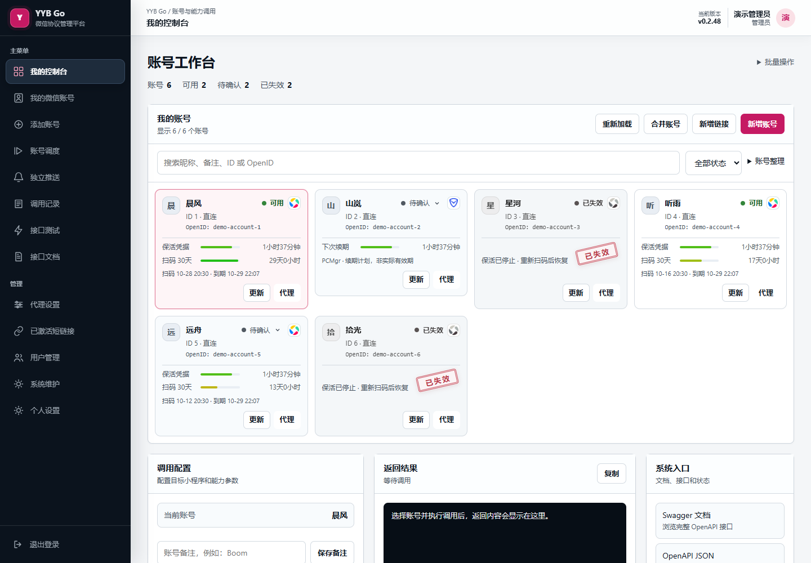
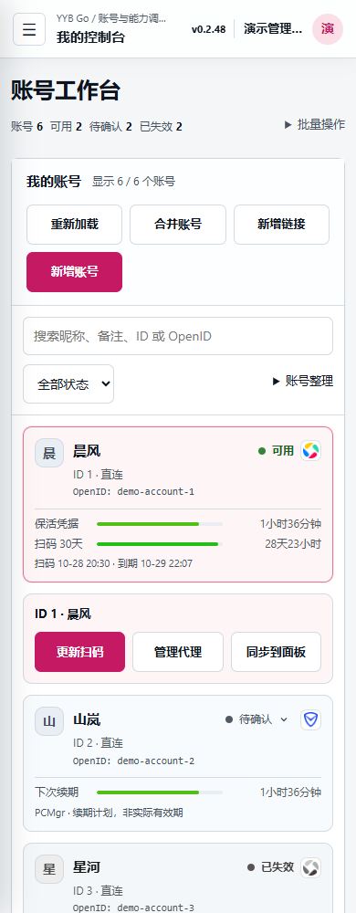
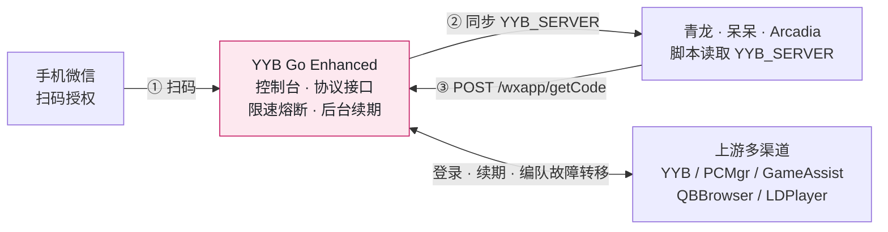

<div align="center">


# YYB Go Enhanced

**面向自托管环境的 YYB 协议服务与微信账号管理平台**

微信扫码登录 · 多渠道编队容错 · 账号与 OpenID 管理 · `wx.login` code 获取 · 凭据续期 · 账号独立代理 · 青龙 / 呆呆 / Arcadia 接入

[](https://github.com/525815266/YYB-Go-Enhanced/releases)
[](https://github.com/525815266/YYB-Go-Enhanced/actions/workflows/docker-publish.yml)
[](https://github.com/525815266/YYB-Go-Enhanced/actions/workflows/release.yml)
[](go.mod)
[](https://github.com/525815266/YYB-Go-Enhanced/commits/main)

[](https://github.com/525815266/YYB-Go-Enhanced)
[](https://github.com/525815266/YYB-Go-Enhanced/forks)
[](https://github.com/525815266/YYB-Go-Enhanced/releases)
[](https://github.com/525815266/YYB-Go-Enhanced/pkgs/container/yyb-go-enhanced)
[](https://github.com/525815266/YYB-Go-Enhanced/releases)
[](https://t.me/+yDbdmAyJsxNjY2Y1)

[**在线演示**](https://525815266.github.io/YYB-Go-Enhanced/) · [风险与版本说明](#使用前必读风险提示与版本说明) · [界面预览](#界面预览) · [快速开始](#docker-compose-快速开始) · [配置速查](#配置速查) · [排障](#常见问题与排障) · [文档导航](#文档导航) · [更新日志](CHANGELOG.md) · [Issues](https://github.com/525815266/YYB-Go-Enhanced/issues)

<sub>欢迎加入 [Telegram 交流群](https://t.me/+yDbdmAyJsxNjY2Y1) 交流部署与排障；在线演示采用虚构数据、不连接真实服务（打不开可用[备用演示](https://raw.githack.com/525815266/YYB-Go-Enhanced/main/docs/demo/index.html)）。</sub>

</div>

## 使用前必读：风险提示与版本说明

### 微信风控与异常封禁提示

> [!WARNING]
> 通过协议持续获取小程序 `wx.login` code 存在**触发微信上游风控及账号异常限制**的风险，请在充分了解边界后使用：
>
> - **常见触发诱因**：短时间高频并发取码、大量青龙任务堆叠在 `00:00` / 整点同时启动、异常脚本死循环无上限重放请求，或把**网站 / 公众号 AppID** 误传给小程序 `/wxapp/getCode`。
> - **已知风控表现**：上游返回 `jslogin_business -12030` / `-13000` 或频繁 `shortlink_application -14`，严重时可能导致**手机真机端小程序登录临时受限**。
> - **本地防护边界**：本项目提供的取码熔断（`v0.3.11+` 已纳入 `-12030 / -13000` 自动会话冷却）、单账号单小程序防刷频控（`v0.3.12+` 默认 10 分钟最多 10 次，超限直接返回本地 `429`）、同账号请求间隔限速（默认 `3s`）、登录预算与网站 AppID 拦截属于**本地流量止血与风控减压手段**，**无法解除或绕过微信上游已下发的限制**。
>
> **安全使用建议：**
> 1. 保持默认的熔断、限速与防刷频控开启，不要为了跑得快将间隔设得过低或关闭保护；
> 2. 青龙等面板任务务必**错峰排程**，避免数十个脚本扎堆在整点同时开跑，并及时停用或限流死循环重试脚本；
> 3. 公众号 / H5 网页授权必须改用 `POST /wx/h5code` 或 `POST /wx/oauth`，**严禁**向 `/wxapp/getCode` 传入网站或公众号 AppID；
> 4. 一旦触发 `-12030` / `-13000` 或真机小程序登录受限，**立即停跑相关脚本并静置 30–48 小时等待微信自动解封**，切勿反复删号重扫。

### 关于「老版本不掉线」与新旧版本能否使用的说明

> [!IMPORTANT]
> **不存在任何已验证可「长期 / 永久不掉线」的老版本或新版本**（包括上游原版 [SuperNaiBA/YYB_GO](https://github.com/SuperNaiBA/YYB_GO) 与早期无版本号构建）。OAuth 授权是否被微信吊销（`42007` / `40030`）由微信上游风控策略与实际脚本调用负载共同决定，**回退旧版本并不能让已封或易掉线的账号恢复“永久不掉线”**。

之所以部分用户感觉“老版本不掉线”，本质上是**状态展示机制与测试负载差异**造成的观感偏差：

- **状态判定的错觉**：上游原版（2026-07-22）没有后台主动保活，且**从不将账号终态标记为“失效 / 需重扫”**——每次取码遇到报错就清掉会话并强行刷新；只要微信尚未撤销 `refresh_token`，它就会静默恢复且界面一直不弹窗，给人“一直在线”的印象；一旦微信真的吊销（`42007`），老版本同样取不到 code（只是持续返回 502）。
- **负载差异的错觉**：早期无版本号构建对照审计显示，在单账号、稀疏、避开整点的低频请求下，“旧版自动续期、新版掉线”的观感往往混杂了**整点全量并发负载差异**与早期版本缺少过期/响应码严格校验所致，并非存在某个神奇的旧版代码免疫吊销。

| 对比维度 | 老版本（上游原版及早期无版本号构建） | 当前增强版（`v0.3.12+`） |
| --- | --- | --- |
| **授权与续期** | 单渠道、无完整终态判定或宽松解析；被 `42007` 吊销后仍持续 502 重试 | 严格响应校验 + 后台按需续期；支持多渠道编队故障转移与指数降权（`15m → 6h`） |
| **风控与刷码止血** | **无熔断、无限速、无刷码拦截**；死循环脚本或整点高峰容易直接把号刷进风控 | 取码熔断（含 `-12030/-13000` 自动冷却）、登录预算、同号限速（`3s`）、单目标防刷频控（`429`） |
| **错误 AppID 防护** | 不拦截网站 / 公众号 AppID 错调 `/wxapp/getCode` | 拦截已知网站 AppID + 动态空码临时限制；公众号 / H5 独立走 `/wx/h5code` 与 `/wx/oauth` |
| **设备与可观测性** | 每次随机设备标识，无结构化运行日志与掉线提醒 | 默认固定设备标识（`stable`）、结构化运行日志、掉线通知与超时阶段诊断 |
| **安全与面板联动** | 无多用户鉴权或仅基础配置，缺乏规范同步 | 独立用户权限、`YYB_PROTOCOL_TOKEN` 全入口校验、青龙 / 呆呆 / Arcadia 保序去重同步 |

**版本选择建议**：在正常合规、错峰低频的负载下，当前版本的常规主授权同样支持长期续期；同时还具备防刷止血、多渠道容错、固定设备和安全隔离，**不建议为了“不掉线”传言退回无任何防护的早期版本**。更多源码证据与实测记录见 [授权稳定性](docs/authorization-stability.md)、[早期无版本号镜像独立审计](docs/unversioned-docker-audit-20261031.md) 与 [旧版与当前版链路对照](docs/old-vs-new-chain-20261101.md)。

---

## 界面预览

<p align="center">
  
</p>

<p align="center">
  
  
  
</p>

<p align="center"><sub>账号工作台、扫码后一键添加到青龙、账号运行管理、手机端工作台。截图均使用虚构账号与数据，可在<a href="https://525815266.github.io/YYB-Go-Enhanced/">在线演示</a>体验交互，功能详情见<a href="docs/console-features.md">控制台与账号管理</a>。</sub></p>

## 核心能力

<table>
  <tr>
    <td width="50%" valign="top"><b>🔀 多扫码渠道与编队</b><br>纯 Go 实现应用宝（YYB）、电脑管家（PCMgr）、手游助手（GameAssist）、QQ 浏览器（免扩展一键登录 / 伴生扩展）及雷电模拟器（实验性，单发无刷新）5 套渠道；同微信可合并多渠道编队，按健康度自动故障转移与指数降权（<code>15m → 6h</code>）；官方撤销全部凭据时仍需重扫</td>
    <td width="50%" valign="top"><b>🛡️ 多层请求保护</b><br>取码熔断（含 <code>-12030 / -13000</code> 自动冷却）、登录预算、同账号请求限速、单账号单小程序短时防刷频控（<code>429</code>）、动态空码临时限制与已知网站 AppID 拦截（流量止血，不保证授权不被吊销）</td>
  </tr>
  <tr>
    <td width="50%" valign="top"><b>👤 账号管理</b><br>手机微信扫码添加、重复扫码原位更新、备注与 OpenID 查看、状态刷新、账号整理压缩、安全删除与多渠道合并</td>
    <td width="50%" valign="top"><b>🖥️ 可视化工作台</b><br>账号搜索、状态筛选、凭据与扫码有效期倒计时、失效状态提示与调用配置管理，原生适配桌面端与移动端</td>
  </tr>
  <tr>
    <td width="50%" valign="top"><b>🔌 全兼容协议接口</b><br>提供 <code>/wx/*</code> 与 <code>/wxapp/*</code> 兼容接口，支持小程序 <code>wx.login</code> code、用户信息、手机号、云函数、公众号 H5 换码及内置 OpenAPI 调试页（<code>/docs</code>）</td>
    <td width="50%" valign="top"><b>🔗 多面板联动</b><br>支持青龙、呆呆、Arcadia OpenAPI；自动保序去重同步 <code>YYB_SERVER</code>（跳过编队子成员冗余项），支持按账号创建、启停、执行任务并查看隔离日志</td>
  </tr>
  <tr>
    <td width="50%" valign="top"><b>🌐 独立代理与保活</b><br>每账号独立保存直连、静态 HTTP/SOCKS5、动态 API、品赞与巨量配置；支持保活走代理而小程序调用走直连；后台按剩余有效期触发刷新</td>
    <td width="50%" valign="top"><b>📜 适配脚本库</b><br>统一收录校验后的 YYB 多账号脚本；内置管理工具支持整库同步、单脚本拉取及安全创建面板定时任务</td>
  </tr>
  <tr>
    <td width="50%" valign="top"><b>🔐 用户与权限隔离</b><br>独立登录注册、管理员与普通用户权限分离、用户启停、密码重置、会话管理，以及全协议入口 <code>YYB_PROTOCOL_TOKEN</code> 校验</td>
    <td width="50%" valign="top"><b>🧾 运行日志与掉线通知</b><br>记录续期、票据恢复、限速与防刷命中事件（不采集密钥与正文），提供超时阶段诊断；授权失效时推送一次提醒（Server酱 / PushPlus / 企业微信）</td>
  </tr>
</table>

## 工作原理

1. **扫码授权**：在控制台选择渠道并用手机微信扫码，YYB Go 保存授权并在后台按需续期，可为每个账号绑定独立代理。
2. **同步面板**：将账号自动写入自动化面板的 `YYB_SERVER`（支持编队合并与保序去重），并可直接在控制台按账号管理脚本任务。
3. **取码与防护**：面板脚本读取 `YYB_SERVER` 调用 `POST /wxapp/getCode` 取码；请求经过本地防刷、限速、熔断与故障转移后路由到健康上游。



---

## 快速开始

| 部署方式 | 适用场景 | 入口 |
| --- | --- | --- |
| **Docker Compose（推荐）** | NAS（飞牛 / 群晖 / Unraid）、VPS、Armbian，与青龙同机或同网络运行 | [Docker Compose 快速开始](#docker-compose-快速开始) |
| **原生二进制** | Linux、Windows、macOS 独立运行，免装运行环境 | [其他部署方式](#其他部署方式) |
| **Magisk 模块** | Android ARM64 设备开机常驻，不依赖 Termux | [Magisk 文档](docs/magisk.md) |
| **源码构建** | 二次开发或本地自行编译镜像 | [其他部署方式](#其他部署方式) |

### Docker Compose 快速开始

环境需要 Docker、Docker Compose v2，以及供面板互通的用户自建网络。默认拉取官方多架构镜像（`linux/amd64` / `linux/arm64`），低功耗盒子无需本机编译。以下是**首次安装**步骤：

```bash
git clone https://github.com/525815266/YYB-Go-Enhanced.git
cd YYB-Go-Enhanced

docker network inspect qinglong_default >/dev/null 2>&1 || \
  docker network create qinglong_default

cp .env.example .env
docker compose pull yyb-go

# 初始化映射目录，使容器的非 root 用户能够写入数据库、头像和二维码
mkdir -p data/db data/avatars data/qr
docker run --rm --user 0 --entrypoint sh \
  -v "$PWD/data:/data" ghcr.io/525815266/yyb-go-enhanced:latest \
  -c 'chown -R yyb:yyb /data/db /data/avatars /data/qr && chmod -R u+rwX /data/db /data/avatars /data/qr'
docker compose up -d --no-build
```

浏览器打开 `http://<服务器地址>:8000`（端口由 `YYB_PORT` 决定）。未预设管理员时，第一个注册的用户自动成为管理员。容器内置健康检查（`/health`）。

> [!TIP]
> **与青龙容器网络互通**：青龙必须加入同一个 Docker 用户自建网络（容器名叫 `qinglong` 不代表网络也叫这个名字）。若青龙当前处于默认 `bridge` 网络，请执行 `docker network connect qinglong_default qinglong`（末位替换为实际容器名）；若已有其他自定义网络，在 `.env` 中设置 `YYB_DOCKER_NETWORK=实际网络名` 即可。青龙重建容器时需在其 Compose 中保留该网络，详见 [Armbian / Docker 部署排错](docs/docker-deployment.md)。

- **日常更新**：执行 `docker compose pull yyb-go && docker compose up -d --no-build`，保留现有 `.env` 和 `data/` 即可；开发者也可通过 `docker compose up -d --build` 从源码构建。
- **默认数据库**：开箱使用内置 SQLite，无需额外配置外部数据库：

```dotenv
YYB_AUTH_DRIVER=sqlite
YYB_AUTH_DSN=
YYB_COOKIE_SECURE=false
```

需要复用 MySQL、预设管理员、启用 HTTPS Cookie 或配置协议令牌时，请参阅 [配置与账号安全](docs/configuration.md)。

### 其他部署方式

<details>
<summary>展开查看：原生二进制（Linux / Windows / macOS）</summary>

从 [Releases](https://github.com/525815266/YYB-Go-Enhanced/releases) 下载对应平台产物（Linux amd64 / arm64 / armv7，Windows amd64 / arm64，macOS amd64 / arm64），控制台资源已内嵌于单一可执行文件；可使用同目录 `checksums.txt` 校验 SHA256。

```bash
# Linux / macOS 示例（文件名以 Release 页面为准）
chmod +x yyb-go-linux-amd64
./yyb-go-linux-amd64
```

```powershell
# Windows PowerShell
.\yyb-go-windows-amd64.exe
```

不配置时只监听本机 `8000` 端口；需要局域网/跨机访问时，请通过 `-host` 或 `YYB_BIND_ADDRESS` 指定监听地址，并配置网页登录及 `YYB_PROTOCOL_TOKEN`。v0.2.25 起支持自动读取可执行文件同级 `.env`（也可用 `-env-file` 指定），详见 [配置方式](docs/configuration.md#配置方式)。

</details>

<details>
<summary>展开查看：Android ARM64 Magisk 模块</summary>

支持 Android ARM64 且已安装 Magisk 20.4+ 的设备，随系统开机后台常驻，无需依赖 Termux。从 [Releases](https://github.com/525815266/YYB-Go-Enhanced/releases) 下载 `yyb-go-magisk-arm64-<版本>.zip` 在 Magisk App 内刷入重启即可。安装路径、升级、数据备份与局域网监听见 [Magisk 文档](docs/magisk.md)。

</details>

<details>
<summary>展开查看：源码构建与自编译</summary>

Docker 环境下执行 `docker compose up -d --build` 会在镜像构建阶段自动运行 `go test ./...` 并打包产物；本地构建跨平台二进制与 Magisk 包的脚本说明见 [构建与发布](docs/release-builds.md)。

</details>

---

## 接入自动化面板与脚本

### 连接自动化面板

可在 Web 控制台保存面板配置，也可写入 `.env`。青龙面板最小配置示例：

```dotenv
PANEL_TYPE=qinglong
QL_URL=http://qinglong:5700
QL_CLIENT_ID=你的 Client ID
QL_CLIENT_SECRET=你的 Client Secret
YYB_QINGLONG_SERVER=yyb-go:8000
YYB_QINGLONG_REPO=525815266_YYB-Go-Enhanced_main/scripts
```

- `QL_URL` 是 YYB Go 访问青龙的地址，`YYB_QINGLONG_SERVER` 是青龙脚本回连 YYB Go 的地址，两者方向相反（控制台 `/api/qinglong/config` 也支持保存与热更新对外回调地址 `server_addr`）；`YYB_QINGLONG_REPO` 是否包含 `_main` 请以青龙容器内实际拉库目录名为准。
- 同步 `YYB_SERVER` 时会自动剥离已被编队合并的冗余子成员、按首次出现行位原地归一化重复项，避免依赖行号序号的脚本发生账号错位。

| 面板 | `PANEL_TYPE` | 连接变量 |
| --- | --- | --- |
| 青龙 | `qinglong` | `QL_URL`、`QL_CLIENT_ID`、`QL_CLIENT_SECRET` |
| 呆呆 | `daidai` | `DAIDAI_URL`、`DAIDAI_APP_KEY`、`DAIDAI_APP_SECRET` |
| Arcadia | `arcadia` | `ARCADIA_URL`、`ARCADIA_TOKEN` |

连接后可在扫码完成页一键同步账号到 `YYB_SERVER`，并在「账号运行管理」中按账号独立创建任务、配置推送、调试脚本和查看日志。跨服务器、呆呆 / Arcadia 细节见 [面板接入与排错](docs/panel-integration.md)。

### 脚本拉取与任务创建

在青龙容器内安装仓库管理工具：

```bash
curl -fsSL https://raw.githubusercontent.com/525815266/YYB-Go-Enhanced/main/tools/yyb-scriptctl.sh \
  -o /ql/data/scripts/yyb-scriptctl.sh
chmod +x /ql/data/scripts/yyb-scriptctl.sh
```

三种操作职责分离，按需选用：

```bash
# 1. 仅同步整个 scripts/ 目录，不自动创建任务
bash /ql/data/scripts/yyb-scriptctl.sh sync

# 2. 仅拉取单个脚本，不创建任务
bash /ql/data/scripts/yyb-scriptctl.sh pull 麦富迪_code版.py

# 3. 拉取脚本并创建（或更新）对应定时任务（请错峰设置 cron）
bash /ql/data/scripts/yyb-scriptctl.sh install 麦富迪_code版.py \
  --cron "13 1 * * *" --name "麦富迪"
```

更多脚本说明与仓库适配清单见 [脚本管理文档](scripts/README.md#青龙脚本拉取工具)。

---

## 调用协议接口

`YYB_SERVER` 环境变量每行对应一个账号（支持数字 ID 或 OpenID）：

```text
http://yyb-go:8000@1
http://yyb-go:8000@账号OpenID
```

获取微信小程序 `wx.login` code：

```bash
curl -X POST http://yyb-go:8000/wxapp/getCode \
  -H 'Content-Type: application/json' \
  -d '{"ref":"1","app_id":"wx0000000000000000"}'
```

> [!CAUTION]
> **公众号 / H5 网页授权严禁调用 `/wxapp/getCode`**：将网站或公众号 AppID 传入小程序取码接口不仅拿不到 code，对照实验中还曾导致账号授权失效。请务必改用 `POST /wx/h5code`（兼容入口 `/wxapp/getH5Code`）或自动换码 `POST /wx/oauth`，具体参数见 [公众号网页授权 code](docs/h5-oauth-code.md)。

- 配置 `YYB_PROTOCOL_TOKEN` 后，所有 `/wx/*` 与 `/wxapp/*` 接口（v0.2.34 起包括资料查询在内全入口统一校验）均需携带 `Authorization: Bearer <token>`。
- 服务运行期间访问 `/docs` 可打开内置 OpenAPI 调试页面，`/openapi.json` 为标准机器可读定义；控制台「接口测试 → 协议令牌」输入的令牌仅保存在当前浏览器页面内存中，不影响青龙配置。
- 完整接口清单与 `operateWxData` 参数边界见 [协议接口说明](docs/protocol-api.md)。

---

## 配置速查

Docker Compose 读取同级 `.env`；原生二进制读取程序旁的 `.env`。生效优先级为：**显式命令行参数 > 已有进程环境变量 > 所选 `.env` > 内置默认值**。环境变量在启动时读取，修改 `.env` 后需重启服务（Docker 需重建容器）。

### 核心服务与面板配置

| 变量 | 默认值与说明 |
| --- | --- |
| `YYB_PORT` | 默认 `8000`。服务监听端口（Compose 中映射到宿主机端口） |
| `YYB_BIND_ADDRESS` | 监听地址。Compose 默认全网卡监听；原生二进制默认仅本机回环 |
| `YYB_AUTH_DRIVER` / `YYB_AUTH_DSN` | 默认 `sqlite` / 空。Web 登录库可选 `sqlite`、`mysql`（需填 DSN）、`none`（仅限受保护本机调试） |
| `YYB_ADMIN_USER` / `YYB_ADMIN_PASSWORD` | 默认空。仅在初始化空用户库时创建预设管理员；留空则首位注册用户为管理员 |
| `YYB_COOKIE_SECURE` | 默认 `false`。部署在 HTTPS 反向代理后务必设为 `true` |
| `YYB_PROTOCOL_TOKEN` | 默认空。`/wx/*` 与 `/wxapp/*` 协议接口令牌；**公网或跨主机强烈建议配置** |
| `YYB_INTEGRATION_TOKEN` | 默认空。可信控制面调用集成接口鉴权令牌 |
| `YYB_ACCOUNT_LINK_KEY` | 默认空。短链接历史 URL 加密密钥；正式环境请固定配置勿随意更换 |
| `PANEL_TYPE` | 默认 `qinglong`。对接面板类型：`qinglong`、`daidai`、`arcadia` |
| `YYB_QINGLONG_SERVER` | 默认 `yyb-go:8000`。面板内脚本回连 YYB Go 的默认地址 |
| `YYB_QINGLONG_REPO` | 默认 `SuperNaiBA_YYB-GO-Script,525815266_YYB-Go-Enhanced/scripts`。账号运行管理扫描的脚本目录（逗号分隔） |
| `YYB_QINGLONG_REF_MODE` | 默认 `id`。写入 `YYB_SERVER` 的账号引用形式：`id` 或 `openid` |

<details>
<summary>展开查看：保活、风控频控、通知环境变量及运行时热调参数</summary>

#### 环境变量（保活、风控保护与维护）

| 变量 | 默认值与说明 |
| --- | --- |
| `YYB_KEEPALIVE_INTERVAL` / `YYB_KEEPALIVE_AHEAD` | 默认 `2m` / `4m`。后台保活检查周期与提前刷新窗口 |
| `YYB_DEVICE_IDENTITY` | 默认 `stable`。为每个账号固定一套协议设备标识；设为 `random` 可切回每次随机（不建议） |
| `YYB_NOTIFY_CHANNEL` / `YYB_NOTIFY_TOKEN` | 默认空。掉线推送渠道：`serverchan`、`pushplus`、`qywx` 及对应令牌 |
| `YYB_CIRCUIT_BREAKER` | 默认 `on`。全局取码熔断开关（`off` 关闭），支持 `-12030 / -13000` 自动会话冷却 |
| `YYB_LOGIN_BUDGET` / `YYB_LOGIN_WINDOW` | 默认 `3` / `10m`。单账号业务调用触发重新登录的滑动窗口次数上限 |
| `YYB_FRESH_SESSION_WINDOW` | 默认 `2m`。刚取到 code 后该窗口内的单个 `-14` 不重登；批取大量不同 AppID 被拦时可调整，见[配置说明](docs/configuration.md#刚成功后的--14-保护v0265-起可调) |
| `YYB_CODE_MIN_GAP` / `YYB_CODE_MAX_WAIT` | 默认 `3s` / `20s`。同一账号向上游发码的最小请求间隔与排队等待上限 |
| `YYB_CODE_ALLOW_APPIDS` / `YYB_CODE_DENY_APPIDS` | 默认空。默认拦截已知网站 AppID（腾讯电脑管家、京东护照）；前者指定白名单，后者追加黑名单 |
| `YYB_CODE_DYNAMIC_DENY` / `YYB_CODE_DYNAMIC_DENY_THRESHOLD` | 默认 `1` / `2`。空码动态临时限制：15 分钟内跨 `2` 个主账号组空码（或累计 `4` 次）暂停 15 分钟，支持 `/api/appid-deny` 查看与解除 |
| `YYB_UPDATE_PROXY` / `YYB_UPDATE_VERSION_URL` | 默认空。仅用于版本更新检查的网络代理与自定义版本源 |

#### 运行时热调参数（`GET/PUT /api/runtime-settings`，管理员免重启生效）

| 参数键 | 默认值与说明 |
| --- | --- |
| `code_min_gap_ms` / `code_max_wait_ms` | 对应同号请求最小间隔（毫秒）与最大排队等待时长（毫秒），写入 `tuning.json` 持久生效 |
| `login_budget` / `login_window_ms` | 对应重新登录预算次数与时间窗口（毫秒），写入 `tuning.json` 持久生效 |
| `fresh_session_window_ms` | 对应刚成功后的 `-14` 保护窗口（毫秒），写入 `tuning.json` 持久生效 |
| `recovery_cooldown_ms` | `v0.3.11+` 新增。会话 `-14` 恢复失败后的退避冷却时长（默认 `300000` 即 5 分钟，上限 `1h`，`0` 关闭），写入 `tuning.json` |
| `code_burst_limit` / `code_burst_window_ms` | `v0.3.12+` 新增。单账号单小程序短时防刷频控（默认 `10` 次 / `600000` 毫秒即 10 分钟；`limit=0` 关闭），写入数据库并即时生效 |
| `dynamic_deny_enabled` / `dynamic_deny_threshold` | 动态空码临时限制的热开关与触发账号数阈值（当前生效至下次重启前） |

</details>

完整参数取值边界、MySQL 与高级设置见 [配置与账号安全](docs/configuration.md)。

---

## 账号代理、保活与稳定性

- **代理模式**：直连、静态 HTTP CONNECT、SOCKS5 及动态 API 均按账号独立保存，支持命名复用品赞 / 巨量配置。
- **调用分离**：支持设置“保活与扫码走代理，小程序调用走直连”，重扫和 ID 整理不会重置该策略；短效动态代理仅用于扫码与临时操作，不参与长期保活。
- **分层判定**：后台依据凭据剩余有效期触发刷新，仅在微信明确拒绝 `refresh_token` 后才标为需重新扫码；所有保护规则与边界说明见 [代理与账号保活](docs/proxy-keepalive.md) 与 [授权稳定性](docs/authorization-stability.md)。

---

## 常见问题与排障

| 常见现象 | 原因与处理入口 |
| --- | --- |
| 触发 `jslogin_business -12030 / -13000` 或真机小程序登录受限 | 账号已被微信上游短期风控，新版已自动触发本地冷却止血；**立即停跑高频/扎堆脚本并静置 30–48 小时**，勿反复删号重扫，详见 [授权稳定性](docs/authorization-stability.md) |
| 取码接口返回 HTTP `429`（含 `code_burst_limited`） | 本地熔断、限速队列或单目标防刷频控生效（默认每账号每小程序 10 分钟最多 10 次）；脚本应按响应头 `Retry-After` 退避并排查死循环脚本，详见 [取码熔断](docs/configuration.md#取码熔断v0259-起) 与 [登录预算与取码限速](docs/configuration.md#登录预算与取码限速v0261-起) |
| 账号显示“需补授权”或提示重新扫码 | [分层处理说明](docs/credential-session-layers.md)、[授权稳定性](docs/authorization-stability.md) |
| 约两小时后账号状态失效 | [失效误判排查](docs/proxy-keepalive.md#约两小时后失效的排查96) |
| 更新 Docker 镜像后页面仍是旧版 | [整套 resource 挂载覆盖镜像](docs/docker-deployment.md#更新后页面仍旧整套-resource-挂载覆盖镜像) |
| SQLite 报 `permission denied` 或 `unable to open database file` | [SQLite / permission denied](docs/docker-deployment.md#sqlite--permission-denied) |
| YYB 与青龙互相连不上或容器名无法解析 | [青龙容器名与网络名不同](docs/docker-deployment.md#青龙容器名与网络名不同)、[跨服务器排错](docs/panel-integration.md#跨服务器排错) |
| 登录后立刻跳回登录页 | 通过 HTTP 访问却开启了 `YYB_COOKIE_SECURE=true`，见 [Cookie 与 HTTPS](docs/configuration.md#cookie-与-https) |

<details>
<summary>展开查看：更多排障项（密码恢复、配置未生效、脚本不显示、409 / 超时、更新网络报错）</summary>

| 现象 | 排查指引 |
| --- | --- |
| 忘记管理员密码 | [本地恢复命令](docs/configuration.md#忘记管理员密码v0232-起) |
| 修改 `.env` 后配置没有生效 | 环境变量仅启动时读取，Docker 修改后需重建容器，见 [配置方式](docs/configuration.md#配置方式) |
| 手动上传的脚本不在“全部脚本”里 | 列表读取的是面板任务而非文件目录，见 [独立上传脚本接入步骤](docs/panel-integration.md#独立上传的脚本不在全部脚本里issue-73) |
| 新增脚本集合后仍不显示 | 核对实际任务路径与容器内环境变量覆盖，见 [目录配置排查](docs/panel-integration.md#新增脚本集合后仍不显示issue-100) |
| 面板 `YYB_SERVER` 出现重复或冗余成员 | `v0.3.12+` 同步已支持保序原地去重并过滤编队子成员；历史清理见 [重复变量处理](docs/panel-integration.md#重复变量处理) |
| 扫码成功后第一次调用即返回 `409` | [409 排查说明](docs/proxy-keepalive.md#scan-first-call-409) |
| 保活正常但取码超时 | 可查看响应 `data.timeout_stage` 定位阶段，详见 [LongLink 回退](docs/proxy-keepalive.md#保活成功但-getcode-超时) |
| 检查更新报连接重置或 HTTP `403` | [更新网络排错](docs/maintenance.md#检查更新报连接重置或-http-403issue-74) |

</details>

> 提交 [Issue](https://github.com/525815266/YYB-Go-Enhanced/issues) 时请附上版本号、部署方式（Docker / 原生 / Magisk）和**脱敏后的日志**，切勿粘贴令牌、Cookie、代理密码或真实 OpenID。

---

## 文档导航

| 文档 | 说明 |
| --- | --- |
| [文档总索引](docs/README.md) | 全部项目文档与调研记录按用途分组索引 |
| [配置与账号安全](docs/configuration.md) | SQLite / MySQL、管理员与权限、令牌、设备固定、熔断与运行参数 |
| [Docker / Armbian 部署排错](docs/docker-deployment.md) | 官方镜像、挂卷覆盖、跨容器网络、SQLite 权限与源码构建排查 |
| [控制台与账号管理](docs/console-features.md) | 工作台、5 套扫码渠道、多渠道编队、接口测试与运行日志 |
| [面板接入与排错](docs/panel-integration.md) | 青龙、呆呆、Arcadia 接入、跨机通信、账号运行管理与日志 |
| [协议接口说明](docs/protocol-api.md) | `/wx/*`、`/wxapp/*`、OAuth、云函数与真实参数边界 |
| [公众号网页授权 code](docs/h5-oauth-code.md) | `/wx/h5code` 与 `/wx/oauth` 用法及 AppID 混用风险 |
| [代理与账号保活](docs/proxy-keepalive.md) | 静态/动态代理、品赞、巨量、保活分流、刷新策略与失效诊断 |
| [授权稳定性](docs/authorization-stability.md) | 防护机制、实验记录与长期稳定性边界说明 |
| [早期无版本号镜像审计](docs/unversioned-docker-audit-20261031.md) · [新旧链路对照](docs/old-vs-new-chain-20261101.md) | 针对“老版本不掉线”反馈的源码级对照与负载分析 |
| [脚本管理](scripts/README.md) | YYB 适配脚本库、拉取工具与公共状态缓存 |
| [Magisk 模块](docs/magisk.md) · [系统维护](docs/maintenance.md) · [构建与发布](docs/release-builds.md) | Android ARM64 模块、宿主机在线更新维护器与多平台发版说明 |

---

## 在线更新与安全边界

- **版本更新**：管理员可在控制台顶栏点击版本号检查更新。裸机与 Magisk 提供对应架构包直下；Docker 在连接宿主机维护执行器后支持在线升级与重启（详见[系统维护](docs/maintenance.md)）。升级前请务必备份 `data/db`（外部 MySQL 请同步备份对应数据库），镜像回滚不等于数据库回滚。完整变更见 [CHANGELOG.md](CHANGELOG.md)，历史包见 [Releases](https://github.com/525815266/YYB-Go-Enhanced/releases)。
- **安全边界**：默认建议运行于可信局域网、VPN 或受控反向代理后；公网部署务必开启 HTTPS、`YYB_COOKIE_SECURE=true` 与高强度 `YYB_PROTOCOL_TOKEN`。严禁提交 `.env`、`data/`、数据库、代理密钥、OpenID 或微信凭据；项目忠实透传上游协议边界，不伪造微信签名、加密数据或授权返回值。

---

## Star History

如果你觉得这个项目有帮助，欢迎点亮仓库右上角的 ⭐ **Star** 支持持续维护！

<div align="center">
  <a href="https://www.star-history.com/#525815266/YYB-Go-Enhanced&Date">
    <picture>
      <source media="(prefers-color-scheme: dark)" srcset="https://api.star-history.com/svg?repos=525815266/YYB-Go-Enhanced&type=Date&theme=dark" />
      <source media="(prefers-color-scheme: light)" srcset="https://api.star-history.com/svg?repos=525815266/YYB-Go-Enhanced&type=Date" />
      
    </picture>
  </a>
</div>

## 参与贡献与致谢

欢迎通过 [Issues](https://github.com/525815266/YYB-Go-Enhanced/issues) 反馈问题、提交脱敏复现线索与改进建议。Docker 镜像构建阶段会自动执行 `go test ./...`，提交代码前建议先在本地运行完整测试；打包与发版流程参阅 [构建与发布](docs/release-builds.md)。

<div align="center">
  <a href="https://github.com/525815266/YYB-Go-Enhanced/graphs/contributors">
    
  </a>
</div>

感谢 [@Xx1aoy1](https://github.com/Xx1aoy1) 提供的 Armbian 实测排查过程，也感谢所有提交 Issue、复现步骤与建议的社区反馈者。

## 许可证与来源

本项目基于 [SuperNaiBA/YYB_GO](https://github.com/SuperNaiBA/YYB_GO) 整理与持续增强。使用和分发时请严格遵守上游授权条款、目标平台规则及所在地法律法规。
