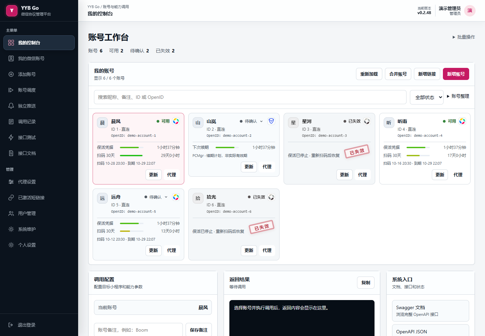
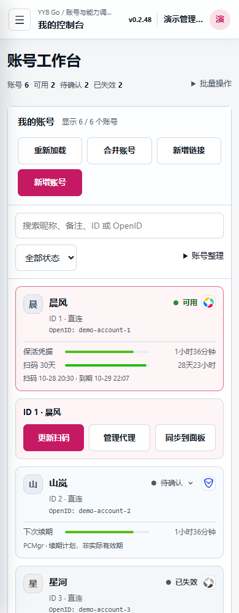
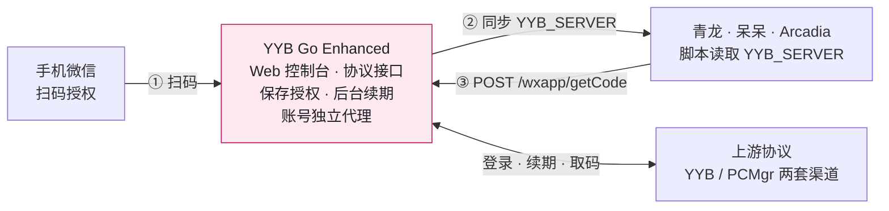

<div align="center">


# YYB Go Enhanced

**面向自托管环境的 YYB 协议服务与微信账号管理平台**

微信扫码登录 · 账号与 OpenID 管理 · `wx.login` code 获取 · 凭据续期 · 账号独立代理 · 青龙 / 呆呆 / Arcadia 接入

[](https://github.com/525815266/YYB-Go-Enhanced/releases)
[](https://github.com/525815266/YYB-Go-Enhanced/actions/workflows/docker-publish.yml)
[](https://github.com/525815266/YYB-Go-Enhanced/actions/workflows/release.yml)
[](go.mod)
[](https://github.com/525815266/YYB-Go-Enhanced/commits/main)

[](https://github.com/525815266/YYB-Go-Enhanced)
[](https://github.com/525815266/YYB-Go-Enhanced/forks)
[](https://github.com/525815266/YYB-Go-Enhanced/releases)
[](https://github.com/525815266/YYB-Go-Enhanced/pkgs/container/yyb-go-enhanced)
[](https://github.com/525815266/YYB-Go-Enhanced/releases)

[**在线演示**](https://525815266.github.io/YYB-Go-Enhanced/) · [快速开始](#docker-compose-快速开始) · [配置速查](#配置速查) · [文档](docs/README.md) · [更新日志](CHANGELOG.md) · [问题反馈](https://github.com/525815266/YYB-Go-Enhanced/issues)

</div>

> 在线演示使用虚构账号和数据，可体验账号切换、扫码、代理、运行日志与接口调试，不连接真实 YYB 服务，也不会保存输入。打不开时可用[备用演示](https://raw.githack.com/525815266/YYB-Go-Enhanced/main/docs/demo/index.html)。

## 界面预览

<p align="center">
  
</p>

<p align="center">
  
  
  
</p>

<p align="center"><sub>账号工作台、扫码后一键添加到青龙、账号运行管理、手机工作台。截图均使用虚构账号和数据，更多说明见<a href="docs/console-features.md">控制台与账号管理</a>。</sub></p>

## 核心能力

<table>
  <tr>
    <td width="50%" valign="top"><b>👤 账号管理</b><br>手机扫码添加账号、重复扫码更新、账号备注、OpenID 查看、状态刷新、账号整理与安全删除、合并账号</td>
    <td width="50%" valign="top"><b>🖥️ 工作台</b><br>账号搜索、状态筛选、凭据与扫码有效期、失效状态提示，支持桌面和手机</td>
  </tr>
  <tr>
    <td width="50%" valign="top"><b>🔀 多扫码渠道</b><br>YYB、PCMgr、GameAssist 三套渠道，纯 Go 实现，无需安装或常驻原客户端；可设个人默认和系统默认，也可临时切换；同一个微信可一次扫多个渠道并合并成一个多渠道账号，请求在渠道间轮换和故障转移</td>
    <td width="50%" valign="top"><b>🔐 用户系统</b><br>独立登录与注册、管理员与普通用户权限、用户启停、密码重置、会话管理</td>
  </tr>
  <tr>
    <td width="50%" valign="top"><b>🔌 协议接口</b><br><code>/wx/*</code> 与 <code>/wxapp/*</code> 兼容接口、小程序 code、用户信息、手机号、云函数与协议调试；内置 OpenAPI 页面（<code>/docs</code>）</td>
    <td width="50%" valign="top"><b>🔗 面板联动</b><br>青龙、呆呆、Arcadia OpenAPI；同步 <code>YYB_SERVER</code>；按账号创建、启停、运行任务并读取隔离日志</td>
  </tr>
  <tr>
    <td width="50%" valign="top"><b>🌐 代理与保活</b><br>每账号独立直连、静态代理、动态代理 API、品赞与巨量配置；凭据按需和后台续期</td>
    <td width="50%" valign="top"><b>📜 脚本管理</b><br>统一收录审核后的 YYB 多账号脚本；支持整库同步、单脚本拉取、拉取并创建任务</td>
  </tr>
  <tr>
    <td width="50%" valign="top"><b>🔔 掉线通知</b><br>授权被拒、需要重新扫码时推送一次，支持 Server酱、PushPlus、企业微信群机器人</td>
    <td width="50%" valign="top"><b>🧾 运行日志</b><br>续期、票据、原生恢复及调用的独立事件，按分类、等级、账号、渠道、时间筛选；不采集密钥或请求正文</td>
  </tr>
  <tr>
    <td width="50%" valign="top"><b>🛡️ 请求保护</b><br>取码熔断、登录预算、同账号请求限速，减少对上游的重复请求（流量控制，不保证授权不被吊销）</td>
    <td width="50%" valign="top"><b>📦 部署维护</b><br>Docker Compose、Android ARM64 Magisk、跨平台内嵌资源二进制；按运行平台提供更新入口</td>
  </tr>
</table>

## 工作方式

1. **扫码**：在控制台用手机微信扫码，YYB Go 保存授权并在后台续期，可为每个账号设置独立代理。
2. **同步**：把账号写入自动化面板的 `YYB_SERVER`，并可按账号创建、启停、运行任务。
3. **取码**：面板里的脚本读取 `YYB_SERVER` 中的 `地址@账号`，调用 `POST /wxapp/getCode` 取得小程序 `wx.login` code。



## 部署选择

| 方式 | 适用场景 | 入口 |
| --- | --- | --- |
| Docker Compose（优先） | NAS、服务器、与青龙同机或同网络运行 | [快速开始](#docker-compose-快速开始) |
| 原生二进制 | Linux、Windows、macOS 独立运行 | [其他部署方式](#其他部署方式) |
| Magisk | Android ARM64 设备常驻运行，不依赖 Termux | [Magisk 文档](docs/magisk.md) |
| 源码构建 | 开发，或自行构建镜像 | [其他部署方式](#其他部署方式) |

## Docker Compose 快速开始

环境需要 Docker、Docker Compose v2，以及供面板互通的用户自建网络。默认拉取官方 `linux/amd64` / `linux/arm64` 镜像，Armbian 盒子无需在本机编译。以下是**首次安装**步骤：

```bash
git clone https://github.com/525815266/YYB-Go-Enhanced.git
cd YYB-Go-Enhanced

docker network inspect qinglong_default >/dev/null 2>&1 || \
  docker network create qinglong_default

cp .env.example .env
docker compose pull yyb-go

# 初始化映射目录，使容器的非 root 用户能够写入数据库、头像和二维码
mkdir -p data/db data/avatars data/qr
docker run --rm --user 0 --entrypoint sh \
  -v "$PWD/data:/data" ghcr.io/525815266/yyb-go-enhanced:latest \
  -c 'chown -R yyb:yyb /data/db /data/avatars /data/qr && chmod -R u+rwX /data/db /data/avatars /data/qr'
docker compose up -d --no-build
```

浏览器打开 `http://<服务器地址>:8000`（端口由 `YYB_PORT` 决定）。未预设管理员时，第一个注册用户自动成为管理员。容器自带健康检查（`/health`）。

青龙也需要加入同一个用户自建网络；容器叫 `qinglong` 不代表网络也叫这个名字。若青龙目前只有 Docker 默认的 `bridge` 网络，可执行 `docker network connect qinglong_default qinglong`（最后一项替换为实际容器名）。已有其他网络时，在 `.env` 设置 `YYB_DOCKER_NETWORK=实际网络名`。青龙重建时还需在其 Compose 中保留该网络，详见 [Armbian / Docker 部署排错](docs/docker-deployment.md)。

后续更新使用 `docker compose pull yyb-go && docker compose up -d --no-build`；保留原 `.env` 和 `data`。开发者仍可选择 `docker compose up -d --build` 源码构建，构建测试保持启用。

默认使用 SQLite，无需额外数据库：

```dotenv
YYB_AUTH_DRIVER=sqlite
YYB_AUTH_DSN=
YYB_COOKIE_SECURE=false
```

需要复用 MySQL、预设管理员、启用 HTTPS Cookie 或配置协议令牌时，参阅 [配置与账号安全](docs/configuration.md)。

## 其他部署方式

**原生二进制**：从 [Releases](https://github.com/525815266/YYB-Go-Enhanced/releases) 下载对应平台的文件（Linux amd64 / arm64 / armv7，Windows amd64 / arm64，macOS amd64 / arm64），控制台页面已内嵌，下载后直接运行；`checksums.txt` 可用于校验 SHA256。

```bash
# Linux / macOS 示例，文件名以 Release 页面为准
chmod +x yyb-go-linux-amd64
./yyb-go-linux-amd64
```

```powershell
# Windows PowerShell
.\yyb-go-windows-amd64.exe
```

不配置时只监听本机 8000 端口；需要其他设备访问时，用 `-host` 或 `YYB_BIND_ADDRESS` 指定监听地址，并同时配置网页登录与协议令牌。原生程序 v0.2.25 起支持自动读取程序旁的 `.env`，也可通过 `-env-file` 指定配置；Windows 不再需要逐项设置系统环境变量。具体用法见[配置方式](docs/configuration.md#配置方式)。

**Magisk**：Android ARM64、Magisk 20.4 或更新版本，随开机后台运行，不需要 Termux 常驻。下载 Release 中的 `yyb-go-magisk-arm64-<版本>.zip`，在官方 Magisk 应用中安装，安装、升级、数据目录和局域网监听见 [Magisk 文档](docs/magisk.md)。

**源码构建**：`docker compose up -d --build` 会在镜像构建阶段运行 `go test ./...`；本地构建多平台产物见[构建与发布](docs/release-builds.md)。

## 配置速查

Docker Compose 部署把 `.env.example` 复制为 `.env` 后修改；原生程序读取程序旁的 `.env`。优先级为**显式命令行参数 > 已有进程环境变量 > 所选 `.env` > 默认值**。配置只在启动时读取，修改后需要重启；Docker 通常需要重新创建容器。

| 变量 | 默认值与说明 |
| --- | --- |
| `YYB_PORT` | 默认 `8000`。服务端口；Compose 中是宿主机映射端口 |
| `YYB_BIND_ADDRESS` | 监听地址。Compose 默认对所有网卡开放，原生程序不设置时只监听本机；只需本机访问时设为本机回环地址 |
| `YYB_AUTH_DRIVER` / `YYB_AUTH_DSN` | 默认 `sqlite` / 空。网页登录库：`sqlite`、`mysql`（需要 DSN）、`none`（关闭登录，只适合受保护的本机调试） |
| `YYB_ADMIN_USER` / `YYB_ADMIN_PASSWORD` | 默认空。预设管理员，仅初始化空用户库时生效；留空则第一个注册用户成为管理员 |
| `YYB_COOKIE_SECURE` | 默认 `false`。通过 HTTPS 反向代理访问时设为 `true` |
| `YYB_PROTOCOL_TOKEN` | 默认空。保护 `/wx/*` 与 `/wxapp/*`；公网或跨主机使用时必须设置 |
| `YYB_INTEGRATION_TOKEN` | 默认空。可信控制面调用集成接口 |
| `YYB_ACCOUNT_LINK_KEY` | 默认空。授权短链接历史 URL 的加密密钥；正式使用时请设置并保持不变 |
| `PANEL_TYPE` | 默认 `qinglong`。面板类型：`qinglong`、`daidai`、`arcadia` |
| `YYB_QINGLONG_SERVER` | 默认 `yyb-go:8000`。面板里的脚本回连 YYB Go 的地址 |
| `YYB_QINGLONG_REPO` | 默认 `SuperNaiBA_YYB-GO-Script,525815266_YYB-Go-Enhanced/scripts`。账号运行管理读取的脚本目录，逗号分隔 |
| `YYB_QINGLONG_REF_MODE` | 默认 `id`。写入 `YYB_SERVER` 的账号引用方式：`id` 或 `openid` |
| `YYB_KEEPALIVE_INTERVAL` / `YYB_KEEPALIVE_AHEAD` | 默认 `2m` / `4m`。保活检查间隔与提前刷新时间 |
| `YYB_DEVICE_IDENTITY` | 默认 `stable`。每个账号固定一套协议设备；`random` 恢复旧行为 |
| `YYB_NOTIFY_CHANNEL` / `YYB_NOTIFY_TOKEN` | 默认空。掉线通知渠道：`serverchan`、`pushplus`、`qywx`，以及对应的 token |
| `YYB_CIRCUIT_BREAKER` | 默认 `on`。取码熔断，`off` 关闭 |
| `YYB_LOGIN_BUDGET` / `YYB_LOGIN_WINDOW` | 默认 `3` / `10m`。登录预算：窗口内因业务请求重新登录的次数上限 |
| `YYB_FRESH_SESSION_WINDOW` | 默认 `2m`。会话刚取到 code 后这段时间内的 `-14` 不重新登录；`off` 或 `0` 关闭，批量取码被拦得太多时用，详见[配置](docs/configuration.md#刚成功后的--14-保护v0265-起可调) |
| `YYB_CODE_MIN_GAP` / `YYB_CODE_MAX_WAIT` | 默认 `3s` / `20s`。同一账号向上游发出请求的最小间隔与最长排队时间 |
| `YYB_CODE_ALLOW_APPIDS` / `YYB_CODE_DENY_APPIDS` | 默认都为空。取码请求默认拒绝已知的网站应用 AppID（腾讯电脑管家、京东护照）；前者放行指定 AppID，后者追加自己的禁用名单，逗号分隔 |
| `YYB_CODE_DYNAMIC_DENY` / `YYB_CODE_DYNAMIC_DENY_THRESHOLD` | 默认 `1` / `2`。空码临时限制：15 分钟窗口内 `2` 个不同主账号组空码（或累计 `4` 次）后限制 15 分钟，之后允许一个正常调用复核，成功即解除；空码不判定应用类型，同一微信的多个渠道不算独立账号。显式白名单优先且不再学习；`0` 关闭，`/api/appid-deny` 可查看时间和逐项解除 |
| `YYB_UPDATE_PROXY` / `YYB_UPDATE_VERSION_URL` | 默认空。仅用于版本检查的代理与版本源 |

完整变量、取值范围和注意事项见 [配置与账号安全](docs/configuration.md)；面板相关变量见下一节。

## 连接自动化面板

可以在 Web 控制台填写连接信息，也可以编辑 `.env`。青龙最小配置如下：

```dotenv
PANEL_TYPE=qinglong
QL_URL=http://qinglong:5700
QL_CLIENT_ID=你的 Client ID
QL_CLIENT_SECRET=你的 Client Secret
YYB_QINGLONG_SERVER=yyb-go:8000
YYB_QINGLONG_REPO=525815266_YYB-Go-Enhanced_main/scripts
```

`QL_URL` 是 YYB Go 访问青龙的地址，`YYB_QINGLONG_SERVER` 是青龙脚本反向访问 YYB Go 的地址，两者方向不同；`YYB_QINGLONG_REPO` 是否带 `_main` 以青龙里的实际目录为准。呆呆和 Arcadia 的变量如下：

| 面板 | `PANEL_TYPE` | 连接变量 |
| --- | --- | --- |
| 青龙 | `qinglong` | `QL_URL`、`QL_CLIENT_ID`、`QL_CLIENT_SECRET` |
| 呆呆 | `daidai` | `DAIDAI_URL`、`DAIDAI_APP_KEY`、`DAIDAI_APP_SECRET` |
| Arcadia | `arcadia` | `ARCADIA_URL`、`ARCADIA_TOKEN` |

连接后可在扫码完成页将账号合并到 `YYB_SERVER`，并在“账号运行管理”中为每个账号独立创建任务、设置推送、执行脚本和查看日志。

呆呆、Arcadia、跨服务器地址、任务路径和常见登录页问题参阅 [面板接入与排错](docs/panel-integration.md)。

## 脚本拉取与任务创建

先在青龙容器内安装管理工具：

```bash
curl -fsSL https://raw.githubusercontent.com/525815266/YYB-Go-Enhanced/main/tools/yyb-scriptctl.sh \
  -o /ql/data/scripts/yyb-scriptctl.sh
chmod +x /ql/data/scripts/yyb-scriptctl.sh
```

三种操作互不混淆：

```bash
# 同步整个 scripts/ 目录，不创建任务
bash /ql/data/scripts/yyb-scriptctl.sh sync

# 只拉取一个脚本，不创建任务
bash /ql/data/scripts/yyb-scriptctl.sh pull 麦富迪_code版.py

# 拉取脚本，并创建或更新对应任务
bash /ql/data/scripts/yyb-scriptctl.sh install 麦富迪_code版.py \
  --cron "13 1 * * *" --name "麦富迪"
```

脚本来源、目录覆盖、任务去重和 Issue #66 的任务名修复说明见 [脚本管理文档](scripts/README.md#青龙脚本拉取工具)。

## 调用协议接口

`YYB_SERVER` 每行一个账号：

```text
http://yyb-go:8000@1
http://yyb-go:8000@账号OpenID
```

获取小程序 `wx.login` code：

```bash
curl -X POST http://yyb-go:8000/wxapp/getCode \
  -H 'Content-Type: application/json' \
  -d '{"ref":"1","app_id":"wx0000000000000000"}'
```

- 公众号 / H5 网页授权不要调用 `/wxapp/getCode`：把网站或公众号 AppID 当小程序取码拿不到 code，对照实验中还出现过账号授权失效。请改用 `POST /wx/h5code`（兼容入口 `/wxapp/getH5Code`）或自动换码 `POST /wx/oauth`，用法见 [公众号网页授权 code](docs/h5-oauth-code.md)。
- 配置了 `YYB_PROTOCOL_TOKEN` 时，请求还需携带 `Authorization: Bearer <token>`；正确令牌可直接用于青龙等自动化调用，无需网页登录。
- v0.2.34 起所有协议入口（包括资料查询）统一校验令牌，旧版本仅配置令牌不足以保护，需要更新服务。
- 运行中的服务在 `/docs` 提供 OpenAPI 页面，`/openapi.json` 是机器可读定义。
- 接口清单、公众号 OAuth 边界和 `operateWxData` 参数说明见 [协议接口说明](docs/protocol-api.md)。

控制台可在「接口测试 → 协议令牌」填写令牌；接口文档使用 `Authorize → ProtocolBearer`（只填令牌值）。控制台输入仅用于当前页面，刷新后清空，不影响账号管理和青龙配置。

## 账号代理与保活

- 直连、静态 HTTP CONNECT、SOCKS5 和动态 API 均按账号独立保存。
- 小程序调用默认跟随账号连接模式，也可单独选择直连；扫码、资料查询与保活仍遵循原账号设置，重扫和 ID 整理不会重置该策略。
- 动态 API 支持 `txt`、`json`、`json2` 及常见嵌套结构，并可复用命名的品赞、巨量配置。
- 短效动态代理只用于扫码和临时请求，不参与账号长期保活。
- 后台按凭据剩余时间触发刷新；微信明确拒绝 refresh token 后才标记为需要重扫。

配置格式、地区匹配、刷新窗口和安全注意事项见 [代理与账号保活](docs/proxy-keepalive.md)。

## 授权稳定性

授权可能被上游拒绝而需要重新扫码，目前没有已验证的办法保证它长期不掉线；项目提供会话保护、取码熔断、登录预算和同账号请求限速（默认间隔 3 秒，是保守的起点）来减少重复请求，机制与验证边界见[授权稳定性](docs/authorization-stability.md)。

## 常见问题与排障

| 现象 | 先看这里 |
| --- | --- |
| 更新镜像后页面仍是旧的 | [整套 resource 挂载覆盖镜像](docs/docker-deployment.md#更新后页面仍旧整套-resource-挂载覆盖镜像) |
| SQLite 报 `permission denied` 或 `unable to open database file` | [SQLite / permission denied](docs/docker-deployment.md#sqlite--permission-denied) |
| YYB 与青龙互相连不上，或容器名无法解析 | [青龙容器名与网络名不同](docs/docker-deployment.md#青龙容器名与网络名不同)、[跨服务器排错](docs/panel-integration.md#跨服务器排错) |
| 登录后马上回到登录页 | 通过 HTTP 访问却设置了 `YYB_COOKIE_SECURE=true`，见 [Cookie 与 HTTPS](docs/configuration.md#cookie-与-https) |
| 忘记管理员密码 | [本地恢复命令](docs/configuration.md#忘记管理员密码v0232-起) |
| 配置修改后没有生效 | 配置只在启动时读取，Docker 通常需要重新创建容器，见[配置方式](docs/configuration.md#配置方式) |
| 手动上传的脚本不在“全部脚本”里 | 列表读取的是面板任务，不是文件浏览器，见[独立上传脚本接入步骤](docs/panel-integration.md#独立上传的脚本不在全部脚本里issue-73) |
| 新增脚本集合后仍不显示 | 核对真实任务路径、Compose 变量覆盖和容器内生效值；仅重启容器不会加载修改后的环境变量，见[目录配置排查](docs/panel-integration.md#新增脚本集合后仍不显示issue-100) |
| 面板里的 `YYB_SERVER` 出现重复项 | [重复变量处理](docs/panel-integration.md#重复变量处理) |
| 扫码成功后第一次调用就返回 409 | [409 排查说明](docs/proxy-keepalive.md#scan-first-call-409) |
| 保活成功但取码超时 | [LongLink 回退](docs/proxy-keepalive.md#保活成功但-getcode-超时) |
| 约两小时后账号失效 | [失效误判排查](docs/proxy-keepalive.md#约两小时后失效的排查96) |
| 取码返回 `429` | 这是本地熔断或限速，不是上游返回；按 `Retry-After` 退避，见[取码熔断](docs/configuration.md#取码熔断v0259-起)与[登录预算与取码限速](docs/configuration.md#登录预算与取码限速v0261-起) |
| 账号显示“需补授权”或需要重新扫码 | [分层处理说明](docs/credential-session-layers.md)、[授权稳定性](docs/authorization-stability.md) |
| 检查更新报连接重置或 HTTP 403 | [更新网络排错](docs/maintenance.md#检查更新报连接重置或-http-403issue-74) |

提交 Issue 时请带上版本号、运行方式（Docker / 原生 / Magisk）和脱敏后的日志，不要贴令牌、Cookie、代理密码或 OpenID。

## 文档导航

| 文档 | 内容 |
| --- | --- |
| [文档索引](docs/README.md) | 全部文档按用途分组 |
| [配置与账号安全](docs/configuration.md) | SQLite/MySQL、管理员、用户权限、令牌、实验性本机微信授权 |
| [Docker / Armbian 部署排错](docs/docker-deployment.md) | 官方镜像、resource 挂载覆盖、网络名、SQLite 权限、源码构建失败 |
| [控制台与账号管理](docs/console-features.md) | 账号工作台、扫码渠道、多渠道账号、合并账号、接口测试、运行日志 |
| [面板接入与排错](docs/panel-integration.md) | 青龙、呆呆、Arcadia、跨服务器访问、运行管理与日志 |
| [协议接口说明](docs/protocol-api.md) | `/wx/*`、`/wxapp/*`、OAuth、云函数与真实 payload 边界 |
| [代理与账号保活](docs/proxy-keepalive.md) | 静态/动态代理、品赞、巨量、刷新策略与失效状态 |
| [授权稳定性](docs/authorization-stability.md) | 防护与诊断措施、验证边界、按版本的记录 |
| [脚本管理](scripts/README.md) | YYB 适配脚本、拉取工具、任务元数据与公共账号缓存 |
| [Magisk 模块](docs/magisk.md) | Android ARM64 安装、升级、局域网监听与 DNS |
| [系统维护](docs/maintenance.md) | Docker 在线检查、宿主机维护执行器、恢复和安全边界 |
| [构建与发布](docs/release-builds.md) | Docker、Magisk、跨平台二进制与 GitHub Actions |

## 更新

管理员可点击控制台顶栏版本号检查新版本。系统会识别当前运行环境：Windows、Linux、macOS 裸机提供匹配架构的 Release 下载，Magisk 提供模块 ZIP；Docker 仅在维护执行器已连接时提供在线更新和重启，详见[系统维护](docs/maintenance.md)。升级前至少备份 `data/db`（使用外部 MySQL 时还要单独备份对应数据库），镜像回滚不等于数据库回滚。

完整版本变化见 [CHANGELOG.md](CHANGELOG.md)，安装包见 [Releases](https://github.com/525815266/YYB-Go-Enhanced/releases)。

## 安全边界

- 默认只在可信局域网、VPN 或受控反向代理后使用，不要直接暴露协议接口和数据库。
- 公网使用时必须配置 HTTPS、`YYB_COOKIE_SECURE=true` 和随机 `YYB_PROTOCOL_TOKEN`。
- 不要提交 `.env`、`data/`、SQLite 数据库、代理密钥、OpenID 或微信登录凭据。
- `wx.login` code 是短期且一次性的；公众号 OAuth code 必须由用户在微信内完成授权后回调产生。
- 项目不会伪造微信返回值，也不会从缺失的业务参数中推导签名、加密数据或授权结果。

## Star History

如果你喜欢这个项目，欢迎点击仓库右上角的 ⭐ **Star**，支持持续更新！

<div align="center">
  <a href="https://www.star-history.com/#525815266/YYB-Go-Enhanced&Date">
    <picture>
      <source media="(prefers-color-scheme: dark)" srcset="https://api.star-history.com/svg?repos=525815266/YYB-Go-Enhanced&type=Date&theme=dark" />
      <source media="(prefers-color-scheme: light)" srcset="https://api.star-history.com/svg?repos=525815266/YYB-Go-Enhanced&type=Date" />
      
    </picture>
  </a>
</div>

## 参与贡献与致谢

欢迎通过 [Issues](https://github.com/525815266/YYB-Go-Enhanced/issues) 反馈问题、提供脱敏后的复现信息和修复建议。镜像构建阶段会运行 `go test ./...`，提交代码前建议先在本地运行；构建和发布流程见[构建与发布](docs/release-builds.md)。

<div align="center">
  <a href="https://github.com/525815266/YYB-Go-Enhanced/graphs/contributors">
    
  </a>
</div>

感谢 [@Xx1aoy1](https://github.com/Xx1aoy1) 提供 Armbian 实测排查过程，也感谢所有提交 Issue、复现步骤和修复建议的反馈者。

## 许可证与来源

项目基于 [SuperNaiBA/YYB_GO](https://github.com/SuperNaiBA/YYB_GO) 整理和增强。使用和分发时请同时遵守上游授权条件、目标平台规则及所在地法律法规。
