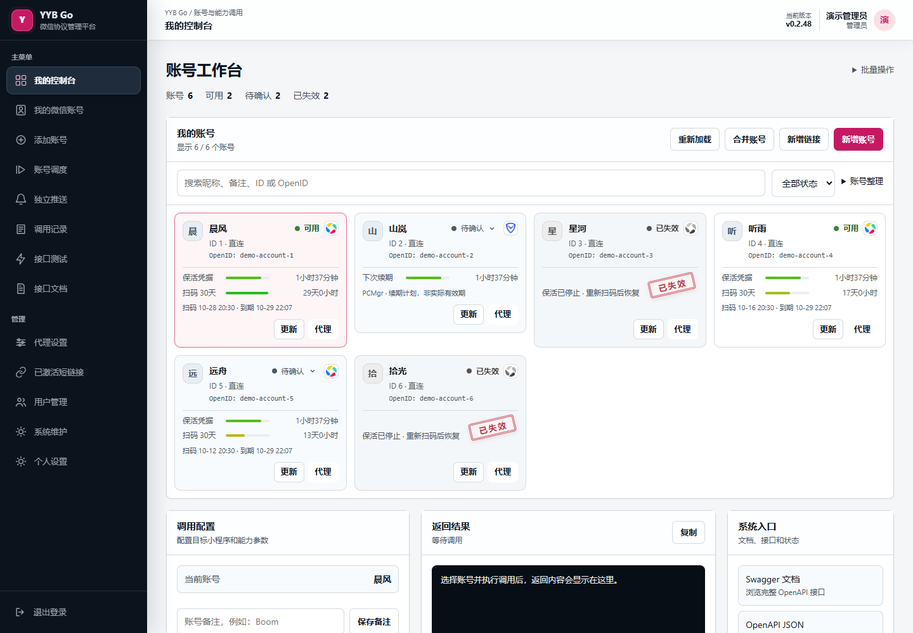
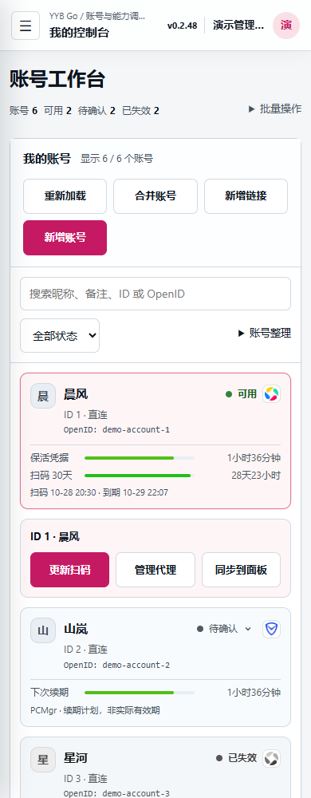

# YYB Go Enhanced

[](https://github.com/525815266/YYB-Go-Enhanced)
[](https://github.com/525815266/YYB-Go-Enhanced/releases)
[](https://github.com/525815266/YYB-Go-Enhanced/actions/workflows/docker-publish.yml)
[](https://github.com/525815266/YYB-Go-Enhanced/actions/workflows/release.yml)

如果你喜欢这个项目，欢迎点击仓库右上角的 ⭐ **Star**，支持持续更新！

面向自托管环境的 YYB 协议服务与微信账号管理平台。提供微信扫码登录、账号与 OpenID 管理、`wx.login` code 获取、凭据续期、账号独立代理，以及青龙、呆呆和 Arcadia 面板接入。

[在线演示](https://525815266.github.io/YYB-Go-Enhanced/) · [备用演示](https://raw.githack.com/525815266/YYB-Go-Enhanced/main/docs/demo/index.html) · [版本发布](https://github.com/525815266/YYB-Go-Enhanced/releases) · [更新日志](CHANGELOG.md) · [脚本目录](scripts/README.md) · [问题反馈](https://github.com/525815266/YYB-Go-Enhanced/issues)

> 在线演示使用虚构账号和数据，可体验账号切换、扫码、代理、运行日志与接口调试，不连接真实 YYB 服务，也不会保存输入。

## 界面预览



工作台支持昵称、备注、ID、OpenID 搜索和状态筛选。v0.2.22 使用紧凑卡片网格，电脑端可在卡片内直接更新扫码、管理代理；手机以单列卡片展示，选中账号后在其下方显示快捷操作。点击“待确认”可确认账号状态，新增账号和新增链接位于顶部。账号区随数量自然展开，已失效账号停止展示有效期倒计时。页面预览使用虚构账号。

<p align="center">
  
  
  
</p>

## 核心能力

| 分类 | 能力 |
| --- | --- |
| 账号管理 | 手机扫码添加账号、重复扫码更新、账号备注、OpenID 查看、状态刷新、账号整理与安全删除 |
| 工作台 | 账号搜索、状态筛选、凭据与扫码有效期、失效状态提示，支持桌面和手机 |
| 用户系统 | 独立登录与注册、管理员与普通用户权限、用户启停、密码重置、会话管理 |
| 协议接口 | `/wx/*` 与 `/wxapp/*` 兼容接口、小程序 code、用户信息、手机号、云函数与协议调试 |
| 面板联动 | 青龙、呆呆、Arcadia OpenAPI；同步 `YYB_SERVER`；按账号创建、启停、运行任务并读取隔离日志 |
| 代理与保活 | 每账号独立直连、静态代理、动态代理 API、品赞与巨量配置；凭据按需和后台续期 |
| 脚本管理 | 统一收录审核后的 YYB 多账号脚本；支持整库同步、单脚本拉取、拉取并创建任务 |
| 部署维护 | Docker Compose、Android ARM64 Magisk、跨平台内嵌资源二进制；按运行平台提供更新入口 |

v0.2.45 保留已认证短连接返回的应用 / 传输拒绝码及首次失败链，避免把上游无正文拒绝统称为解密失败。v0.2.44 修复单个应用空 code 误删共享会话、触发账号恢复的问题：应用取码失败返回 502，保留仍可用于其他应用的会话与凭据。v0.2.43 补齐主刷新与 check-login 两段错误链的诊断，v0.2.42 修正官方登录请求的版本字段层级；见[逐字段对照](docs/native-wire-layout-20261029.md)、[近期项目对照](docs/yyb-upstream-review-20261029.md)和[409 排查说明](docs/proxy-keepalive.md#scan-first-call-409)。默认每两分钟检查、提前四分钟续期，token 先保存、登录票据按需获取；多架构原生 Release 和 Magisk 正常维护。近期快速失效的共同根因和 30 天保活尚未验证解决。

近期生产复测仍有凭据被上游明确拒绝；此前三个账号的短时取码通过不代表持续保活已恢复。这些修补不能恢复已被微信撤销的 refresh token，也未验证 30 天保活。实际结果与限制见[协议复核](docs/protocol-audit-20261028.md)和[官方客户端续期对照](docs/native-keepalive-audit-20261028.md)。

v0.2.52 补齐原生 AutoAuth：保存独立恢复密钥与设备，现有会话失去资格或取码被拒时优先恢复；发送前标记密钥已尝试，新密钥先保存、后探测，避免断线重放或取消请求丢失轮换。新授权已用正式代码完成独立新连接恢复及取码，长期续期继续验证。详见[原生恢复记录](docs/native-autoauth-recovery.md)，不将短时成功描述为 OAuth 或 30 天续期已解决。

v0.2.53 在管理员左侧新增“运行日志”，支持分类、等级、账号、渠道和时间筛选，可查看续期、票据、原生恢复及调用的独立事件。日志重启保留，近 7 天最多 10,000 条，不采集密钥或请求正文。补齐 PCMgr 票据 / 主 key 错误链，并记录[官方持久状态与当前恢复差异](docs/pcmgr-official-state-20261030.md)；延时原生恢复仍有失败，另有按需新票据恢复成功样本，持续授权问题尚未解决。[最新反馈与候选方案复核](docs/issue-review-20261030.md)说明官方 demo 的依赖、版本差异及验证边界。

已对 #116 提供的独立 runtime 包完成真实扫码验证：登录成功，取码仍被 `-12 / no permission` 拒绝，包内未实现续期。见[请求通路与实测记录](docs/runtime-transfer-review-20261030.md)；目前未作为正式扫码渠道接入。

此前的[失效误判修复](docs/proxy-keepalive.md#约两小时后失效的排查96)、[脚本可用性记录](scripts/README.md#脚本可用性记录97-2026-10-19)、[管理员密码恢复](docs/configuration.md#忘记管理员密码v0232-起)、[LongLink 回退](docs/proxy-keepalive.md#保活成功但-getcode-超时)与[面板变量原位更新](docs/panel-integration.md#重复变量处理)继续保留。

v0.2.46 按服务端下发的 PSK 期限复用会话，兼容已有 30 分钟本地缓存记录，避免缓存到期就强制重新登录；不改 OAuth 到期或扫码时间。多架构 Release 已发布，Windows 正式文件实际启动与飞牛部署后的旧会话真实取码均通过；这不等于 OAuth 后台续期或 30 天保活已验证。若更新镜像后页面仍旧，见[整套 resource 挂载排错](docs/docker-deployment.md#更新后页面仍旧整套-resource-挂载覆盖镜像)。

10 月 29 日第四轮 OAuth 拒绝后，原 ILink 会话仍可取码，确认两层不能合并判定；v0.2.51 已完成下述分层处理。原始证据保留于[第四轮终止记录](docs/native-keepalive-audit-20261028.md#第四轮终止oauth-拒绝与仍可用的原协议会话15411544)，长期续期仍未验证。

## 部署选择

v0.2.51 修复取码卡在旧会话 `-14`：保留原缓存，使用现有授权取得新票据，候选会话取码成功后才替换；失败不删原会话、不刷新凭据，且限制尝试频率。真实私有副本对照已复现旧缓存失败、新会话及再次复用成功。

OAuth 拒绝与协议会话分开处理：授权被拒但仍有可尝试的 PSK 或独立原生恢复材料时显示“需补授权”，停止重试旧凭据，尝试保留的协议会话及原生恢复。材料缺失或手动标失效后停止使用。清除失效 token，保留扫码时间，不将取码当成 OAuth 续期成功，也不自动恢复历史失效账号。具体范围和真实验证见[分层处理说明](docs/credential-session-layers.md)。

v0.2.50 根据 #105 / #112 的对照，停止因单独应用层 `-14` 删除共享会话或强制恢复账号，当前请求仍返回带阶段诊断的 502。真实授权拒绝和后台续期规则保留，快速失效与长期保活仍待验证。接口测试按能力分组并显示当前 YYB / PCMgr 渠道，展开“测试命令”可复制跟随访问地址、账号和参数的 Bash / PowerShell 示例；服务端自动判断渠道，无需改已有脚本路由。示例只引用环境变量，不填入页面中的真实令牌。详见[反馈复核与验证范围](docs/issue-review-20261029.md)。

v0.2.49 修复 PCMgr 部分请求仍携带 YYB 身份的问题，并按原生路径拆分手机号请求。接口测试会显示当前渠道与能力限制；文章入口是未验证的兼容转发，公众号入口只生成授权 URL。旧授权曾在 Go 与本机官方 DLL 均返回 `20138/1`；重新扫码后，飞牛正式版本的取码、密钥和手机号响应已通过限定目标的真实复测，测试期间授权不变。旧构造在本次密钥对照中也成功，不能将此前失败全部归因于字段混用，或据此宣称长期续期已恢复。Windows 正式程序启动与飞牛部署均通过，详见[调用路径与实测范围](docs/pcmgr-api-paths-20261029.md)。

v0.2.48 支持 YYB / PCMgr 两套扫码渠道，Linux / Docker / Windows 均使用纯 Go 实现，无需安装或常驻原客户端。“个人设置 → 扫码渠道”可设置个人默认，管理员可设置系统默认，优先级为本次手选 > 个人默认 > 系统默认。更新链接及扫码页可临时切换，先说明影响并确认，扫码成功后替换原 ID 的授权，保留代理、归属、任务和推送设置，不新增账号 ID。

同渠道更新仍核对原 OpenID；跨渠道身份标识不同，无法仅凭 OpenID 自动证明是同一微信，请使用原微信扫码。若新身份已属于其他账号，拒绝替换。平台管理的面板变量自动迁移旧 OpenID 引用，数字 ID 引用保持不变；面板暂不可用时保留迁移记录，重新同步可重试。手动维护的外部 OpenID 引用需自行更新。

误从“新增账号”录入了另一条记录时，可在账号区点击“合并账号”，选择来源与保留 ID，预览后确认。原 ID 的代理、归属、备注、任务和推送保留，来源授权移入后释放来源 ID。仅允许同一归属下合并；来源不可用或已有专属任务时先处理再合并，避免遗留指向旧 ID 的任务。系统不能自动证明跨渠道是同一微信，需自行核对两条记录。

卡片右上角 logo 区分渠道。YYB 展示凭据与扫码周期两条进度，PCMgr 展示“下次续期”计划，不把它当成真实有效期。纯 Go 主动轮换、取新票据及小程序取码已通过本地实测；v0.2.49 完成新扫码后的飞牛 API 复测，长期自然续期仍未验证，详见[双路径实现与验证边界](docs/pcmgr-local-lab-20261029.md)。

| 方式 | 适用场景 | 入口 |
| --- | --- | --- |
| Docker Compose | NAS、服务器、与青龙同机或同网络运行 | [快速开始](#docker-compose-快速开始) |
| Magisk | Android ARM64 设备常驻运行，不依赖 Termux | [Magisk 文档](docs/magisk.md) |
| 原生二进制 | Linux、Windows、macOS 独立运行 | [Releases](https://github.com/525815266/YYB-Go-Enhanced/releases) |

原生程序 v0.2.25 起支持自动读取程序旁的 `.env`，也可通过 `-env-file` 指定配置；Windows 不再需要逐项设置系统环境变量。具体用法见[配置方式](docs/configuration.md#配置方式)。

## Docker Compose 快速开始

环境需要 Docker、Docker Compose v2，以及供面板互通的用户自建网络。默认拉取官方 `linux/amd64` / `linux/arm64` 镜像，Armbian 盒子无需在本机编译。以下是**首次安装**步骤：

```bash
git clone https://github.com/525815266/YYB-Go-Enhanced.git
cd YYB-Go-Enhanced

docker network inspect qinglong_default >/dev/null 2>&1 || \
  docker network create qinglong_default

cp .env.example .env
docker compose pull yyb-go

# 初始化映射目录，使容器的非 root 用户能够写入数据库、头像和二维码
mkdir -p data/db data/avatars data/qr
docker run --rm --user 0 --entrypoint sh \
  -v "$PWD/data:/data" ghcr.io/525815266/yyb-go-enhanced:latest \
  -c 'chown -R yyb:yyb /data/db /data/avatars /data/qr && chmod -R u+rwX /data/db /data/avatars /data/qr'
docker compose up -d --no-build
```

打开 `http://服务器IP:8000`。未预设管理员时，第一个注册用户自动成为管理员。

青龙也需要加入同一个用户自建网络；容器叫 `qinglong` 不代表网络也叫这个名字。若青龙目前只有 Docker 默认的 `bridge` 网络，可执行 `docker network connect qinglong_default qinglong`（最后一项替换为实际容器名）。已有其他网络时，在 `.env` 设置 `YYB_DOCKER_NETWORK=实际网络名`。青龙重建时还需在其 Compose 中保留该网络，详见 [Armbian / Docker 部署排错](docs/docker-deployment.md)。

后续更新使用 `docker compose pull yyb-go && docker compose up -d --no-build`；保留原 `.env` 和 `data`。开发者仍可选择 `docker compose up -d --build` 源码构建，构建测试保持启用。

默认使用 SQLite，无需额外数据库：

```dotenv
YYB_AUTH_DRIVER=sqlite
YYB_AUTH_DSN=
YYB_COOKIE_SECURE=false
```

需要复用 MySQL、预设管理员、启用 HTTPS Cookie 或配置协议令牌时，参阅 [配置与账号安全](docs/configuration.md)。

## 连接自动化面板

可以在 Web 控制台填写连接信息，也可以编辑 `.env`。青龙最小配置如下：

```dotenv
PANEL_TYPE=qinglong
QL_URL=http://qinglong:5700
QL_CLIENT_ID=你的 Client ID
QL_CLIENT_SECRET=你的 Client Secret
YYB_QINGLONG_SERVER=yyb-go:8000
YYB_QINGLONG_REPO=525815266_YYB-Go-Enhanced_main/scripts
```

连接后可在扫码完成页将账号合并到 `YYB_SERVER`，并在“账号运行管理”中为每个账号独立创建任务、设置推送、执行脚本和查看日志。

呆呆、Arcadia、跨服务器地址、任务路径和常见登录页问题参阅 [面板接入与排错](docs/panel-integration.md)。

## 脚本拉取与任务创建

先在青龙容器内安装管理工具：

```bash
curl -fsSL https://raw.githubusercontent.com/525815266/YYB-Go-Enhanced/main/tools/yyb-scriptctl.sh \
  -o /ql/data/scripts/yyb-scriptctl.sh
chmod +x /ql/data/scripts/yyb-scriptctl.sh
```

三种操作互不混淆：

```bash
# 同步整个 scripts/ 目录，不创建任务
bash /ql/data/scripts/yyb-scriptctl.sh sync

# 只拉取一个脚本，不创建任务
bash /ql/data/scripts/yyb-scriptctl.sh pull 麦富迪_code版.py

# 拉取脚本，并创建或更新对应任务
bash /ql/data/scripts/yyb-scriptctl.sh install 麦富迪_code版.py \
  --cron "13 1 * * *" --name "麦富迪"
```

脚本来源、目录覆盖、任务去重和 Issue #66 的任务名修复说明见 [脚本管理文档](scripts/README.md#青龙脚本拉取工具)。

手动上传的脚本不出现在“全部脚本”中？列表读取已配置目录内的**面板任务**，不是文件浏览器。请按[独立上传脚本接入步骤](docs/panel-integration.md#独立上传的脚本不在全部脚本里issue-73)配置目录、创建任务，再刷新列表。

新增脚本集合后仍未显示？按[目录配置排查](docs/panel-integration.md#新增脚本集合后仍不显示issue-100)核对真实任务路径、Compose 变量覆盖和容器内生效值；仅重启容器不会加载修改后的环境变量。

## 调用协议接口

`YYB_SERVER` 每行一个账号：

```text
http://yyb-go:8000@1
http://yyb-go:8000@账号OpenID
```

获取小程序 `wx.login` code：

```bash
curl -X POST http://yyb-go:8000/wxapp/getCode \
  -H 'Content-Type: application/json' \
  -d '{"ref":"1","app_id":"wx0000000000000000"}'
```

如果配置了 `YYB_PROTOCOL_TOKEN`，请求还需携带 `Authorization: Bearer <token>`。接口清单、公众号 OAuth 边界和 `operateWxData` 参数说明见 [协议接口说明](docs/protocol-api.md)，运行中的服务也提供 OpenAPI 页面。

控制台可在「接口测试 → 协议令牌」填写；接口文档使用 `Authorize → ProtocolBearer`（只填令牌值）。控制台输入仅用于当前页面，刷新后清空，不影响账号管理和青龙配置。

v0.2.34 修复了 #101 的协议令牌校验遗漏，统一保护资料查询等所有协议入口。旧版本仅配置令牌不足以修复此问题，需要更新服务；正确令牌仍可直接用于青龙等自动化调用，无需网页登录。

## 账号代理与保活

- 直连、静态 HTTP CONNECT、SOCKS5 和动态 API 均按账号独立保存。
- 小程序调用默认跟随账号连接模式，也可单独选择直连；扫码、资料查询与保活仍遵循原账号设置，重扫和 ID 整理不会重置该策略。
- 动态 API 支持 `txt`、`json`、`json2` 及常见嵌套结构，并可复用命名的品赞、巨量配置。
- 短效动态代理只用于扫码和临时请求，不参与账号长期保活。
- 后台按凭据剩余时间触发刷新；微信明确拒绝 refresh token 后才标记为需要重扫。

配置格式、地区匹配、刷新窗口和安全注意事项见 [代理与账号保活](docs/proxy-keepalive.md)。

## 文档导航

| 文档 | 内容 |
| --- | --- |
| [配置与账号安全](docs/configuration.md) | SQLite/MySQL、管理员、用户权限、令牌、实验性本机微信授权 |
| [面板接入与排错](docs/panel-integration.md) | 青龙、呆呆、Arcadia、跨服务器访问、运行管理与日志 |
| [协议接口说明](docs/protocol-api.md) | `/wx/*`、`/wxapp/*`、OAuth、云函数与真实 payload 边界 |
| [代理与账号保活](docs/proxy-keepalive.md) | 静态/动态代理、品赞、巨量、刷新策略与失效状态 |
| [脚本管理](scripts/README.md) | YYB 适配脚本、拉取工具、任务元数据与公共账号缓存 |
| [Magisk 模块](docs/magisk.md) | Android ARM64 安装、升级、局域网监听与 DNS |
| [系统维护](docs/maintenance.md) | Docker 在线检查、宿主机维护执行器、恢复和安全边界 |
| [构建与发布](docs/release-builds.md) | Docker、Magisk、跨平台二进制与 GitHub Actions |

## 更新

管理员可点击控制台顶栏版本号检查新版本。系统会识别当前运行环境：Windows、Linux、macOS 裸机提供匹配架构的 Release 下载，Magisk 提供模块 ZIP；Docker 仅在维护执行器已连接时提供在线更新和重启。

v0.2.24 根据 #74 的反馈，增加仅供版本检查使用的 `YYB_UPDATE_PROXY` 和可选的 `YYB_UPDATE_VERSION_URL`，并修复前端过早取消备用查询的问题。默认仍使用官方 Raw / API / Release 来源，不内置第三方镜像。遇到连接重置或 403，请按[更新网络排错](docs/maintenance.md#检查更新报连接重置或-http-403issue-74)检查容器到宿主机代理的可达性；Docker 拉取镜像使用宿主机的独立网络配置。感谢 @Xx1aoy1 提供 Armbian 实测排查过程。

完整版本变化见 [CHANGELOG.md](CHANGELOG.md)。

## 安全边界

- 默认只在可信局域网、VPN 或受控反向代理后使用，不要直接暴露协议接口和数据库。
- 公网使用时必须配置 HTTPS、`YYB_COOKIE_SECURE=true` 和随机 `YYB_PROTOCOL_TOKEN`。
- 不要提交 `.env`、`data/`、SQLite 数据库、代理密钥、OpenID 或微信登录凭据。
- `wx.login` code 是短期且一次性的；公众号 OAuth code 必须由用户在微信内完成授权后回调产生。
- 项目不会伪造微信返回值，也不会从缺失的业务参数中推导签名、加密数据或授权结果。

## 来源

项目基于 [SuperNaiBA/YYB_GO](https://github.com/SuperNaiBA/YYB_GO) 整理和增强。使用和分发时请同时遵守上游授权条件、目标平台规则及所在地法律法规。
